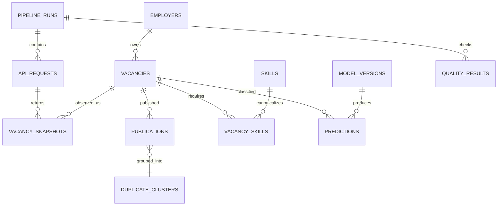

# Модель данных

## ER-карта

## Основные таблицы

### `ops.pipeline_runs`

`run_id uuid PK`, `pipeline_name text`, `snapshot_date date`, `started_at timestamptz`, `finished_at`, `status`, `code_version`, `config_hash`, `error_summary`. Unique для логического запуска задаётся осознанно; ручной rerun хранить отдельно через `attempt_no`.

### `raw.api_requests`

`request_id uuid PK`, `run_id FK`, `query_id`, `area_id`, `page_no`, `request_params jsonb`, `http_status`, `requested_at`, `received_at`, `items_count`, `found_count`, `raw_path`, `sha256`, `status`. Unique `(run_id, query_id, area_id, page_no)`; index `(received_at)`.

### `raw.vacancy_snapshots`

`snapshot_id bigserial PK`, `run_id FK`, `vacancy_id text`, `snapshot_at`, `payload jsonb`, `payload_hash`, `source_request_id FK`. Unique `(vacancy_id, snapshot_at, payload_hash)`; GIN только при доказанной потребности.

### `core.employers`

`employer_id text PK`, `name`, `normalized_name`, `url`, `trusted`, `first_seen_at`, `last_seen_at`.

### `core.vacancies`

Текущая каноническая карточка: `vacancy_id text PK`, `employer_id FK nullable`, `name_raw`, `name_normalized`, `description_html`, `description_text`, `area_id`, `area_name`, `published_at`, `created_at`, `archived_at`, `experience_code`, `employment_code`, `schedule_code`, `accept_temporary`, `alternate_url`, `first_seen_at`, `last_seen_at`, `content_hash`.

### `core.publications`

История наблюдений: `publication_id bigserial PK`, `vacancy_id FK`, `snapshot_date`, `published_at`, `content_hash`, `is_active`, `source_snapshot_id FK`, `duplicate_cluster_id nullable`, `is_representative`. Unique `(vacancy_id, snapshot_date)`; indexes `(snapshot_date, is_active)`, `(employer_id через join не индексировать здесь)`.

### `core.salary_offers`

`vacancy_id PK/FK`, исходные `from_raw`, `to_raw`, `currency_raw`, `gross_raw`; нормализованные `from_rub`, `to_rub`, `midpoint_rub`, `is_gross`, `period`, `fx_date`, `fx_rate`, `normalization_status`, `assumptions jsonb`. Не заменять missing на 0.

### `core.skills` и `core.vacancy_skills`

`skills`: `skill_id`, `canonical_name`, `category`, `active`, `dictionary_version`.

`vacancy_skills`: `(vacancy_id, skill_id, source, match_text, section, confidence, extractor_version)`; PK `(vacancy_id, skill_id, extractor_version)`.

### `ml.model_versions` и `ml.predictions`

Model: `model_version PK`, `target`, `algorithm`, `trained_at`, `dataset_version`, `feature_hash`, `metrics jsonb`, `artifact_path`, `status`.

Prediction: `vacancy_id`, `target`, `predicted_class`, `confidence`, `class_probabilities jsonb`, `model_version nullable`, `rules_version nullable`, `decision_path`, `predicted_at`. Unique по vacancy/target/version.

### `ml.seniority_scores`

`vacancy_id`, `score`, компоненты `explicit_experience`, `title_signal`, `responsibility_signal`, `education_signal`, итоговый `bucket`, `rules_version`, `explanation jsonb`.

### `core.duplicate_clusters`

`cluster_id uuid PK`, `method`, `threshold`, `created_at`, `algorithm_version`; membership хранить отдельно: `cluster_id`, `publication_id`, `similarity`, `is_representative`.

## Витрины и grain

- `mart.vacancy_current`: 1 строка на representative active vacancy на `as_of_date`.
- `mart.market_daily`: дата x role x seniority x area.
- `mart.skill_demand_daily`: дата x role x seniority x skill.
- `mart.salary_distribution`: дата x role x seniority x area x currency policy.
- `mart.employer_activity`: дата x employer x role.
- `mart.vacancy_match_features`: vacancy x skill/role/seniority attributes.

## Уточнение зарплат

Различать диапазон, нижнюю/верхнюю границу и неизвестное. Gross/net пересчитывать только при явно принятой налоговой политике; иначе показывать раздельно. Валютный курс хранить с датой и источником. Подозрение на годовой формат отмечать, не исправлять молча.
